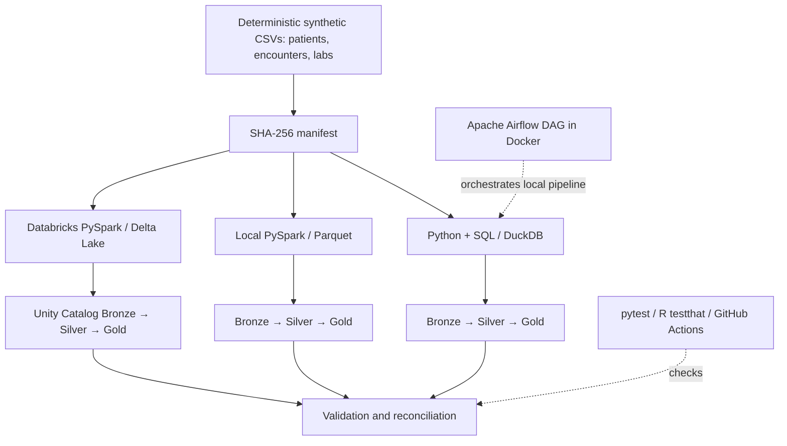

# Healthcare Data Engineering Platform

**End-to-End Synthetic Healthcare Lakehouse | Python • SQL • DuckDB • Apache Airflow • Docker • R • PySpark • Databricks • Delta Lake**

> **Portfolio demonstration only.** All input records are synthetic. No patient data, employer data, or confidential intellectual property is required. This is **not** a clinical application, HIPAA-compliant deployment, or production healthcare service.

## Overview

This project demonstrates the end-to-end data engineering lifecycle: generating source data, capturing an ingestion manifest, landing Bronze records, creating validated Silver models, building Gold analytics tables, enforcing data-quality gates, orchestrating runs, testing code, and reconciling results across local and cloud engines.

The project has **three implementations**:

| Implementation | Storage / engine | Orchestration or execution | Validation |
|---|---|---|---|
| Local SQL lakehouse | DuckDB, Python, SQL | CLI / Apache Airflow in Docker | 11 QC checks and 3 pytest tests |
| Local Spark lakehouse | PySpark, Parquet | Local Python / Spark | 12 Spark QC checks |
| Cloud lakehouse | Databricks serverless, Delta Lake, Unity Catalog | Databricks notebook; job configuration can be added | 12 notebook QC checks; reconciled Gold totals |

### Architecture



## Synthetic dataset and confirmed results

| Dataset | Row count |
|---|---:|
| Patients | 250 |
| Encounters | 1,200 |
| Laboratory records | 1,200 |

Validated Gold-layer departmental totals:

| Department | Encounters | Total encounter cost |
|---|---:|---:|
| Cardiology | 425 | $383,687.74 |
| General | 368 | $353,443.61 |
| Oncology | 407 | $390,844.31 |
| **Total** | **1,200** | **$1,127,975.66** |

**Observed validation evidence:** 3/3 Python tests passed; 11/11 DuckDB quality checks passed; 5 successful R testthat assertions; four Airflow DAG runs reported `success`; local PySpark reported 12/12 checks passed; Databricks notebook reported all 12 checks passed, and Gold totals matched local outputs. These are development-test results, not production SLAs. A GitHub Actions run and a Databricks Job run should be verified separately; configuration/source control does not prove cloud job deployment.

## Repository structure

```text
.github/workflows/ci.yml       # CI workflow
Dockerfile                     # Custom Airflow image
compose.yaml                   # Airflow local service (host port 8085 in this setup)
dags/healthcare_pipeline_dag.py
src/generate_data.py           # Synthetic source generator
src/pipeline.py                # DuckDB ETL and quality gate
sql/models.sql                 # Silver and Gold SQL models
tests/test_pipeline.py         # Determinism, idempotency, invalid-data rejection
r/quality_summary.R            # Independent R quality checks
spark/                         # Local PySpark implementation (if added)
databricks/OPTIONAL_PYSPARK.py # Original small example
databricks/healthcare_lakehouse.py # Validated notebook source (if exported to repo)
resources/healthcare_job.yml   # Optional, version-controlled job definition
(databricks.yml)               # Optional bundle root configuration
data/raw/                      # Generated source CSVs, ignored by Git
data/processed/                # Generated DuckDB outputs, ignored by Git
data/spark/                    # Generated Spark Parquet outputs, ignored by Git
```

Some optional paths exist only after you copy or export the corresponding add-on files. Confirm the repository contents before claiming those components are committed.

## 1. Run the local Python + DuckDB pipeline

On macOS, from the repository root:

```bash
python3 -m venv .venv
source .venv/bin/activate
python -m pip install -r requirements.txt
python -m src.pipeline --stage all
python -m pytest -v
python -m json.tool data/processed/quality_report.json
```

If a moved virtual environment points to an old directory, rebuild `.venv`. Always prefer `python -m pytest` to ensure the intended Python interpreter runs tests.

The pipeline writes `data/raw/manifest.json`, `data/processed/health_analytics.duckdb`, and `data/processed/quality_report.json`. The manifest contains SHA-256 hashes for data lineage and reproducibility. The quality gate checks uniqueness, null or missing IDs, referential integrity, plausible values, nonnegative costs, and nonempty Gold output. Test cases check deterministic data generation, repeatable execution/idempotency, and correct rejection of invalid data.

### Query the Gold layer

```bash
python - <<'PY'
import duckdb
con = duckdb.connect('data/processed/health_analytics.duckdb', read_only=True)
print(con.execute('''
    SELECT department, SUM(encounter_count) AS encounters,
           ROUND(SUM(total_cost), 2) AS total_cost
    FROM gold_daily_utilization
    GROUP BY department ORDER BY department
''').df().to_string(index=False))
con.close()
PY
```

## 2. Orchestrate local ETL with Docker + Airflow

```bash
docker compose up --build -d
docker compose ps
docker compose logs airflow --tail=100
```

For this developer's configuration, `compose.yaml` exposes container port 8080 on **http://localhost:8085**, avoiding another app on local port 8080. Check your own `compose.yaml` mapping before opening the URL.

In the Airflow UI, enable/trigger the `synthetic_healthcare_lakehouse` DAG. Its four stages are `ingest → bronze → model → quality`.

```bash
docker compose exec airflow airflow dags list-runs -d synthetic_healthcare_lakehouse
```

**Airflow vs Docker:** Airflow defines and schedules the DAG; Docker packages and runs the Airflow environment. The standalone Airflow user is for local development only. Its credentials are managed in the running Airflow service and should never be copied into the repository or README.

## 3. Independent R QC

```bash
Rscript -e 'install.packages(c("dplyr", "readr", "testthat"), repos="https://cloud.r-project.org")'
Rscript r/quality_summary.R
```

The R script validates source records separately and calculates department summaries. This demonstrates use of R libraries and tests; it is **not** a standalone production R package.

## 4. Run the local PySpark / Parquet pipeline

Install Java 17 at the macOS level and PySpark in your Python virtual environment. Example using Homebrew:

```bash
brew install openjdk@17
sudo ln -sfn "$(brew --prefix openjdk@17)/libexec/openjdk.jdk" /Library/Java/JavaVirtualMachines/openjdk-17.jdk
export JAVA_HOME=$(/usr/libexec/java_home -v 17)
export PATH="$JAVA_HOME/bin:$PATH"
python -m pip install 'pyspark>=4.0,<4.3'
java -version
python -c 'import pyspark; print(pyspark.__version__)'
```

With `spark/run_local.py` added, run:

```bash
python -m src.pipeline --stage all
python -m spark.run_local --input data/raw --output data/spark
python -m json.tool data/spark/spark_quality_report.json
```

The Spark implementation reads all three CSV sources and creates Parquet Bronze/Silver/Gold outputs. Its 12 checks include Silver-to-Gold encounter reconciliation. Java/Hadoop native-library warnings on macOS do not necessarily indicate failure; check the output status.

## 5. Run the Databricks / Delta Lake notebook

1. Sign into a Databricks workspace with access to serverless compute and Unity Catalog.
2. Select your writable catalog. In this project's validated run, the configured location was **`workspace.healthcare_de`** and the managed Volume was **`health_portfolio`**. Adjust names for other workspaces.
3. Upload the generated `patients.csv`, `encounters.csv`, and `labs.csv` to `/Volumes/workspace/healthcare_de/health_portfolio/`.
4. Open the `Healthcare_Lakehouse_Pipeline` Python notebook or import the exported `databricks/healthcare_lakehouse.py` source file.
5. Set `CATALOG = "workspace"`, `SCHEMA = "healthcare_de"`, and `VOLUME = "health_portfolio"`; run the notebook on serverless compute.
6. Confirm that the notebook's quality gate prints `PASS` and that Gold departmental counts/costs reconcile with the table above.

Notebook output confirms 12 QC checks with zero violations in the validated run. Tables use the `hc_` prefix, including `hc_silver_encounters` and `hc_gold_daily_utilization`.

### Validate persisted Delta tables

```python
from pyspark.sql import functions as F
silver = spark.table(f"{CATALOG}.{SCHEMA}.hc_silver_encounters")
gold = spark.table(f"{CATALOG}.{SCHEMA}.hc_gold_daily_utilization")
assert silver.count() == 1200
assert gold.agg(F.sum("encounter_count")).first()[0] == 1200
display(gold.groupBy("department").agg(
    F.sum("encounter_count").alias("encounters"),
    F.round(F.sum("total_cost"), 2).alias("total_cost")
).orderBy("department"))
```

### Databricks Job and source control

The notebook and a Databricks Job are different artifacts. Export the working notebook as a `.py` source file and commit it to `databricks/`. A `databricks.yml` plus `resources/healthcare_job.yml` can describe a deployable Databricks bundle, **but treat the YAML as a draft until you validate and deploy it in your workspace**. Adding the YAML to Git does not deploy, change, or prove the execution of an existing Databricks Job. Avoid frequent schedules on limited Free Edition resources.

## 6. GitHub Actions / CI

The workflow is under `.github/workflows/ci.yml`. After pushing, open the **Actions** tab and confirm that the actual workflow run passed. Local `pytest` success is not evidence of GitHub-hosted CI success until checked on GitHub.

Generated files and credentials should not be committed. Use GitHub Desktop to commit and push if terminal authentication is difficult.

## Security and credentials — read before publishing

**You do not need to put a Databricks username or password in any project file.** Logging into the Databricks web UI does not automatically insert login credentials into the notebook, PySpark script, GitHub repository, or job YAML. The `CATALOG`, `SCHEMA`, `VOLUME`, and workspace paths identify resources, not passwords. Email addresses and workspace paths may reveal identity or environment details but are not authenticators.

For local Databricks CLI/SDK use, credentials are commonly kept in `~/.databrickscfg` (outside this repository) or provided through environment variables. Never commit `.databrickscfg`, `.env`, `.env.*`, tokens, OAuth secrets, service-principal secrets, or `.pem` keys. Use OAuth profiles or properly managed secrets for real deployments, and rotate any token that was publicly exposed.

**Recommended additional `.gitignore` entries:**

```gitignore
.databrickscfg
.env
.env.*
!.env.example
*.pem
*.key
data/raw/
data/processed/
data/spark/
.venv/
__pycache__/
.pytest_cache/
```

### Inspect tracked files without printing secret values

From the repository root:

```bash
# Which files are tracked?
git ls-files

# Flag likely credential-bearing filenames without opening them
 git ls-files | grep -Ei '(^|/)(\.env|\.databrickscfg|credentials|secrets|token)(/|\.|$)' || true

# Identify lines mentioning authentication fields (review carefully; do not share values)
 git grep -n -i -E 'DATABRICKS_TOKEN|DATABRICKS_PASSWORD|CLIENT_SECRET|api[_-]?key|password[[:space:]]*=' -- ':!README.md' || true
```

This is a basic screen, not a complete secret scan. A real scanner (e.g. `gitleaks`) can catch more patterns. **If a secret was ever committed, deleting it from the latest file is not enough**: revoke/rotate the credential and assess Git history. Do not paste secret-bearing results into support chats or issues.

## Limits and extensions

This is a local/cloud learning demonstration using synthetic batch data. It does not yet implement live EHR integrations, production-grade access governance, PHI controls, streaming Kafka, CDC, incremental upserts, alerting, full observability, or disaster recovery. Possible next steps: Databricks bundle validation and deployment, GitHub Actions cloud job automation, dbt, S3/object storage, Kafka, Terraform, and monitoring.


