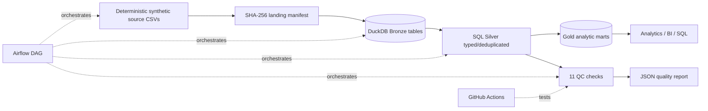

# Synthetic Healthcare Data Lakehouse — End-to-End Data Engineering Portfolio

 

**Purpose:** demonstrate full data engineering lifecycle: ingestion → bronze landing → SQL silver transforms → gold marts → quality gates → scheduled orchestration → CI/CD. **All datasets are synthetic. No real patient data or employer IP.**

## Architecture



## Technologies
Python 3.11+, DuckDB (SQL analytics warehouse), CSV batch ingestion, SHA-256 audit manifest, SQL window functions, pytest, GitHub Actions, Apache Airflow (Docker option), R/dplyr/testthat (optional cross-language QC), Databricks/PySpark/Delta (optional separately deployed example).

## Quick start — works without Docker or cloud accounts

```bash
python3 -m venv .venv
source .venv/bin/activate   # Windows PowerShell: .venv\Scripts\Activate.ps1
pip install -r requirements.txt
python -m src.pipeline --stage all
pytest -q
```

Inspect results:
```bash
python - <<'PY'
import duckdb
c=duckdb.connect('data/processed/health_analytics.duckdb',read_only=True)
print(c.execute('SELECT * FROM gold_daily_utilization LIMIT 10').df().to_string(index=False))
PY
```

Outputs: `data/raw/manifest.json`, `data/processed/health_analytics.duckdb`, and `data/processed/quality_report.json`.

## Optional Airflow Docker orchestration

Run `docker compose up --build`, then open http://localhost:8080. Find login details in `docker compose logs airflow`. Enable and trigger the `synthetic_healthcare_lakehouse` DAG. This Docker setup is for learning, not production deployment.

## Optional R quality control

Install R packages `dplyr`, `readr`, `testthat`, and run `Rscript r/quality_summary.R` after the Python pipeline.

## Optional Databricks PySpark / Delta

See `databricks/OPTIONAL_PYSPARK.py`. Upload the synthetic encounters CSV to a Unity Catalog Volume and update `base_path` and table identifiers for your workspace. This separate sample is not required by the verified local pipeline.

## Reliability and tests

- Deterministic source generation, SHA-256 input manifest.
- Bronze source snapshots; silver typed, deduplicated tables; gold aggregated marts.
- 11 QC assertions: primary keys, null values, referential integrity, nonnegative costs, plausible ages, and nonempty gold output.
- Failure raises an exception; JSON report records status; GitHub Actions runs tests.
- Idempotent batch replacement (no accidental duplicate records on re-run).

## Suggested demo screenshots

1. Terminal displaying `PASS` data quality status.
2. A SQL query against `gold_daily_utilization`.
3. GitHub Actions passing tests.
4. Airflow DAG screen after testing Docker option.

## Limitations

This is a learning portfolio, not an actual clinical platform or a HIPAA-compliant deployment. There is no EHR integration, PHI, production alerting, CDC, streaming, or incremental processing. Possible next steps: S3 storage, dbt, cloud CI/CD, streaming Kafka, Terraform, and monitoring.

## Publish to your GitHub

Create an **empty** GitHub repository named `healthcare-data-engineering-platform` (without auto-generated README). Then run:

```bash
git init
git add .
git commit -m "Build healthcare data lakehouse portfolio"
git branch -M main
git remote add origin https://github.com/YOUR_USERNAME/healthcare-data-engineering-platform.git
git push -u origin main
```

Replace `YOUR_USERNAME` with your GitHub account name.

## Resume example (once tested)

Built an end-to-end synthetic healthcare analytics lakehouse using Python, SQL, and DuckDB, with automated ETL, bronze/silver/gold modeling, 11 quality checks, GitHub CI, and optional Airflow, R, and Databricks components.
